# PDF reader

PDF reader stores a book, reads its pages, and lets you chat about it.
The demo is the web app: sign up, upload a PDF, wait until it is parsed, then open a chat next to the PDF.

<video src="https://github.com/user-attachments/assets/f8e214d0-c06a-420b-b1a7-e0ed0c2ca554" controls></video>

## 0. Architecture and technologies

The app service and the chatbot use onion architecture and domain-driven design. The domain sits in the centre and depends on nothing. The service layer handles commands and events. Infrastructure (databases, files, queues, and the chat provider) sits outside and depends inward. FastAPI is only the entrance: it turns an HTTP call into a command.

| Service | Where | What lives there |
| --- | --- | --- |
| App | `services/app/manger` | Domain: User and Book. Services: sign up, sign in, add book. Infrastructure: Postgres, local files, RabbitMQ. |
| Chatbot | `services/chatbot/manger` | Domain: Session and Message. Services: create session, infer. Infrastructure: chat Postgres, the app database, parsed pages, and an OpenAI-compatible client. |
| Parsing | `services/parsing` | A worker, not an onion. It takes a queue message, renders pages, calls vLLM, writes JSON, and marks the book parsed. |

Technologies: Python 3.11, FastAPI, SQLAlchemy, Postgres 16, RabbitMQ, vLLM with PaddleOCR-VL, React and Vite, Docker Compose, and `uv`.

## 1. Design

The product is four services. The browser talks to the web app. The web app calls the app API for accounts, files, and book status, and the chatbot API for sessions. The app API writes the file and a `parse_book` message. The parsing worker reads that queue, asks vLLM to read the page, and sets `is_parsed`. Chat starts only after that.

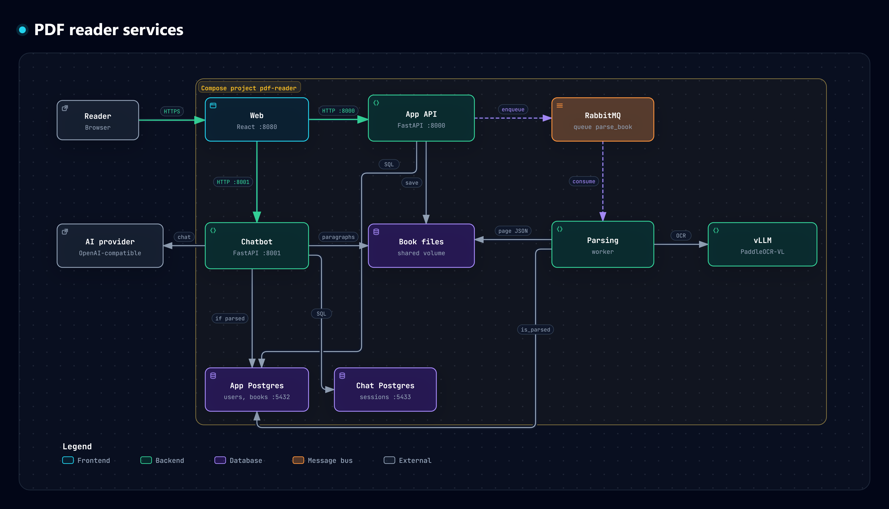

### App

Accounts and books. The domain does not know about HTTP, SQL, or the queue.

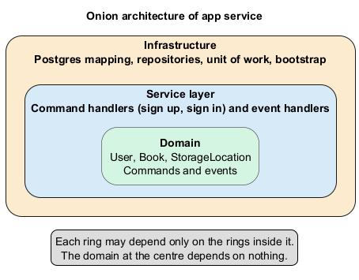

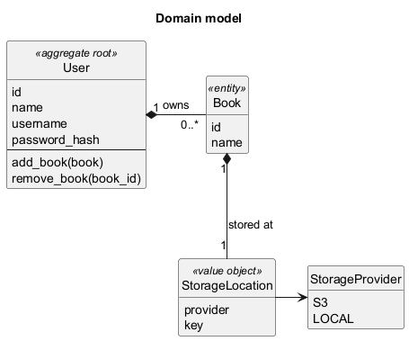

Sign-in checks the password and returns the user id.

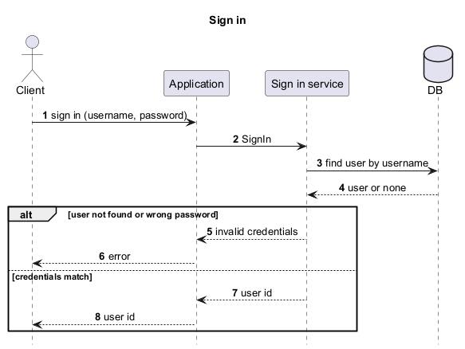

Sign-up rejects a taken username, stores a password hash, and returns the user id.

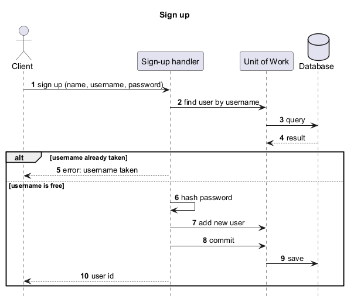

### Chatbot

A session is tied to one parsed book. Infer sends the history to the configured chat model and stores the reply.

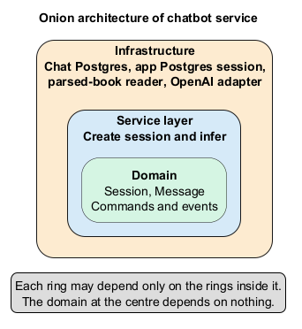

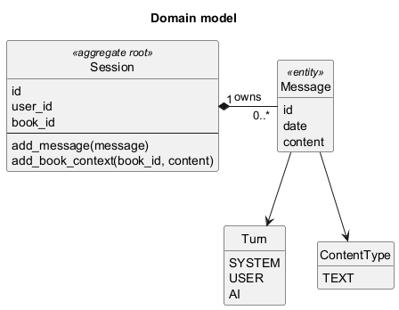

Create session loads the parsed paragraphs into the first system message.

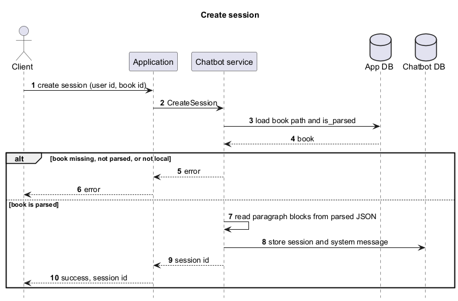

Infer appends the user message, asks the model, and stores both turns.

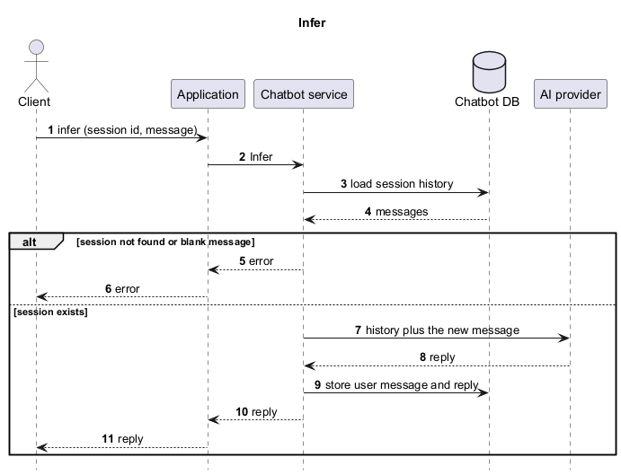

### Parsing

One queue, one worker. The worker does not serve HTTP.

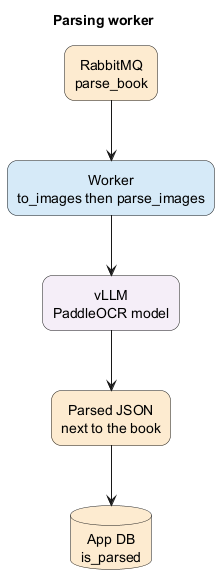

A local file is rendered, read by vLLM, saved as JSON, then marked parsed. Anything that is not on local storage is rejected.

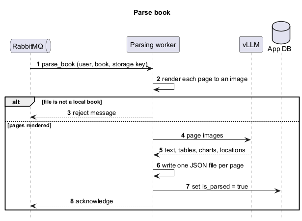

## 2. How to run

From `services`. You need Docker, an NVIDIA GPU for vLLM, and a chat API key.

Put the chat settings in `services/chatbot/.env`. Do not commit that file with a real key.

```
OPENAI_API_KEY=
OPENAI_MODEL=
OPENAI_BASE_URL=
```

`OPENAI_BASE_URL` is the API root. Leave it empty for the official OpenAI API, or set `https://openrouter.ai/api/v1` for OpenRouter. `OPENAI_MODEL` is the model name that server expects.

`services/.env` is already filled for Docker: database, RabbitMQ, and vLLM hostnames are the Compose service names. Change those only if you change ports or passwords.

```powershell
cd services
docker compose up --build
```

Open `http://127.0.0.1:8080`.

| What | Address |
| --- | --- |
| Web | `http://127.0.0.1:8080` |
| App API | `http://127.0.0.1:8000` |
| Chatbot API | `http://127.0.0.1:8001` |
| App Postgres | `localhost:5432`, database `pdf_reader` |
| Chat Postgres | `localhost:5433`, database `chatbot` |

The first vLLM start downloads PaddleOCR-VL and can take several minutes. Parsing stays down until `http://127.0.0.1:8092/health` returns OK.

Stop:

```powershell
docker compose down
```

Per-service commands, for running one process on the host with `uv`, are in [services/README.md](services/README.md).
